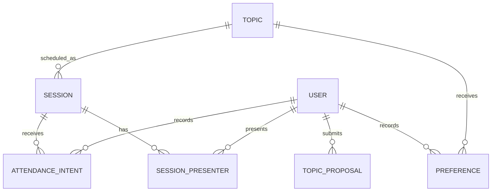

# Lab Seminar Planner – Software Requirements

## 1. Project Background

The laboratory plans to run approximately eight student seminars or workshops during the semester. The group includes students from different year groups and with different technical interests and levels of experience.

In previous semesters, seminar topics were mainly selected by the academic lead and then assigned to student presenters. This worked reasonably well, but it provided limited visibility of student interest and did not clearly distinguish between:

- topics that students would like to attend;
- topics that students are willing to present;
- topics that should remain part of the seminar programme regardless of popularity;
- optional topics competing for a limited number of seminar slots.

A lightweight web application is therefore required to support topic selection, presenter volunteering and semester planning.

The system is intended for a small internal user group. It does not need the complexity of a formal university teaching or timetabling system.


## 2. Development Objectives

The system shall provide a simple way to:

1. publish a pool of seminar topics;
2. distinguish between core and optional topics;
3. collect students' interest in attending each topic;
4. collect students' willingness to present or co-present a topic;
5. allow students to propose additional topics;
6. summarise voting and presenter availability;
7. assist organisers in selecting approximately eight sessions for the semester;
8. publish the provisional and confirmed semester programme;
9. allow students to indicate their expected attendance for confirmed sessions.

The application should remain small enough to be understood and maintained by students.

The first release should prioritise correct business logic and clear interaction over visual sophistication.


## 3. System Glossary

| Term | Meaning |
|---|---|
| **User** | A member of the laboratory who can log in to the system. |
| **Student** | A normal user who can browse topics, submit preferences, volunteer to present and indicate expected attendance. |
| **Organiser** | A user with permission to manage topics, review results, assign presenters and publish the semester plan. |
| **Topic** | A proposed subject for a seminar or workshop. |
| **Core Topic** | A topic that is expected to appear in the semester programme regardless of voting results. |
| **Optional Topic** | A topic competing for one of the remaining seminar slots. |
| **Topic Proposal** | A new topic submitted by a student for possible inclusion in the topic pool. |
| **Interest Level** | A student's level of interest in attending an optional topic. |
| **Presentation Preference** | A student's willingness to lead, co-present or possibly contribute to a topic. |
| **Session** | A scheduled seminar or workshop based on a selected topic. |
| **Semester Plan** | The set of sessions selected and scheduled for the semester. |
| **Attendance Intention** | A student's indication of whether they expect to attend a scheduled session. |
| **Candidate Plan** | A system-generated or organiser-adjusted proposal for the semester programme before final publication. |


## 4. Core Functional Requirements

### 4.1 User Authentication

The system shall allow registered users to log in.

For the initial release:

- accounts may be created in advance by an organiser;
- self-registration is not required;
- password reset is not required;
- a simple role model consisting of `student` and `organiser` is sufficient.

Passwords must not be stored in plain text.


### 4.2 Topic Pool

Users shall be able to browse all currently available seminar topics.

Each topic shall contain at least:

- title;
- short description;
- category;
- type: `core` or `optional`;
- keywords;
- status.

The interface should allow users to distinguish clearly between core and optional topics.

Suggested topic categories may include:

- software engineering;
- artificial intelligence;
- computer vision;
- robotics;
- research methods;
- competition experience;
- generative media;
- interactive film;
- game development;
- open topic.

The category list should be configurable rather than hard-coded into the application logic.


### 4.3 Topic Proposals

Students shall be able to submit new topic proposals.

A proposal shall contain at least:

- title;
- short description;
- keywords or category;
- optional note explaining why the topic may be useful or interesting.

New proposals shall not automatically enter the active voting pool.

An organiser shall be able to:

- approve;
- edit;
- reject;
- archive

a submitted proposal.


### 4.4 Interest Preferences

Students shall be able to express their interest in attending each optional topic.

The initial implementation shall support four states:

| Value | Meaning |
|---|---|
| 3 | Very interested |
| 2 | Interested |
| 1 | Slightly interested |
| 0 | No preference |

A student shall have no more than one active interest preference for the same topic.

Students shall be able to revise their selections while voting remains open.

The system shall calculate an interest score for each optional topic:

$$
\text{InterestScore}
=
3N_3 + 2N_2 + N_1
$$

where $N_3$, $N_2$ and $N_1$ are the numbers of users selecting the corresponding interest levels.


### 4.5 Presentation Preferences

Students shall also be able to indicate whether they are willing to contribute to presenting a topic.

The following states shall be supported:

- `lead`;
- `co_present`;
- `maybe`;
- `none`.

Presentation preference shall be stored independently from attendance interest.


### 4.6 Voting Results

Students shall be able to view summary results for the topic pool.

The public summary should include:

- topic title;
- interest score;
- number of potential lead presenters;
- number of potential co-presenters;
- number of `maybe` presenters;
- current selection status.

Individual voting choices do not need to be displayed to other students.

Organisers shall be able to inspect individual preferences where necessary for assigning presenters.


### 4.7 Candidate Semester Plan

The system shall assist organisers in selecting a semester programme.

The expected default structure is:

- four core topics;
- four optional topics;
- approximately eight sessions in total.

The initial recommendation mechanism may remain simple.

It should:

1. include all active core topics;
2. rank optional topics by interest score;
3. identify topics with no available presenter;
4. favour topics with at least one `lead` or `co_present` volunteer;
5. allow organisers to override the ranking;
6. allow organisers to replace one optional topic with another.

The system must not automatically treat voting results as final.

An organiser shall always be able to modify the candidate plan before publication.


### 4.8 Session Scheduling

For each selected topic, an organiser shall be able to create a session containing:

- topic;
- week or date;
- status;
- presenter or presenters.

Suggested session states are:

- `proposed`;
- `confirmed`;
- `completed`;
- `cancelled`.

The system does not need to perform full automatic timetable optimisation.


### 4.9 Semester Plan

Users shall be able to view the current semester plan.

Each session should display:

- date or teaching week;
- topic;
- presenter or presenters;
- status;
- topic category.

The application should make a clear distinction between provisional and confirmed sessions.


### 4.10 Attendance Intention

Once a session has been confirmed, students shall be able to record an expected attendance status.

The first release shall support:

- `attend`;
- `probably_attend`;
- `probably_absent`;
- `not_sure`.

Attendance intention is for planning purposes only and shall not be treated as formal attendance data.


### 4.11 Organiser Functions

An organiser shall be able to:

- create and edit topics;
- mark topics as core or optional;
- approve student topic proposals;
- open and close voting;
- view preference results;
- assign presenters;
- create and modify sessions;
- generate or revise the candidate semester plan;
- publish the confirmed semester plan;
- archive obsolete topics.

A complex permissions framework is not required for the first release.


## 5. Technical Recommendations

The system should use a deliberately simple architecture.

A suitable implementation would be:

```text
Browser
   |
FastAPI
   |
Server-rendered UI or lightweight frontend
   |
SQLite
```

### Recommended Backend

- Python 3
- FastAPI
- SQLAlchemy
- Pydantic
- SQLite

SQLite is sufficient for the expected user volume and simplifies deployment.

### Recommended Frontend

Suitable options include:

- Jinja2 with HTMX;
- React;
- Vue.

A server-rendered interface with Jinja2 and HTMX is preferred where the main objective is to keep the project small and easy to understand.

### Deployment

The system may initially run:

- locally;
- on an internal laboratory server;
- or on a small cloud virtual machine.

If exposed to the public Internet, HTTPS shall be enabled.

### Testing

The project should include automated tests for at least:

- login;
- preference creation and update;
- duplicate preference prevention;
- score calculation;
- candidate topic ranking;
- organiser-only operations.


## 6. Acceptance Criteria

### Authentication

- [ ] A registered user can log in successfully.
- [ ] Invalid credentials are rejected.
- [ ] Passwords are stored securely.
- [ ] Student and organiser permissions are distinguishable.

### Topic Management

- [ ] Users can view all active topics.
- [ ] Core and optional topics are clearly distinguished.
- [ ] Organisers can create and edit topics.
- [ ] Students can submit topic proposals.
- [ ] Organisers can approve or reject proposals.

### Preferences

- [ ] Students can record an interest level for an optional topic.
- [ ] Students can record a presentation preference independently.
- [ ] Students can revise their preferences.
- [ ] A user cannot have duplicate active preference records for the same topic.
- [ ] Interest scores are calculated correctly.

### Results

- [ ] Users can view aggregate topic rankings.
- [ ] Presenter availability is shown separately from interest.
- [ ] Individual student choices are not exposed unnecessarily.

### Semester Planning

- [ ] Core topics can be included automatically in a candidate plan.
- [ ] Optional topics can be ranked using collected preferences.
- [ ] Topics without potential presenters can be identified.
- [ ] Organisers can override system recommendations.
- [ ] Organisers can create an approximately eight-session semester plan.
- [ ] The confirmed plan is visible to all users.

### Sessions and Attendance

- [ ] Presenters can be assigned to sessions.
- [ ] Sessions can be given dates or teaching weeks.
- [ ] Students can record expected attendance for confirmed sessions.
- [ ] Aggregate expected attendance is displayed.

### Engineering Quality

- [ ] The project can be installed and started from documented instructions.
- [ ] The database can be initialised from a clean environment.
- [ ] A small set of automated tests is provided.
- [ ] The repository contains a clear README.
- [ ] Known limitations are documented.
- [ ] The system can be used by the current laboratory group without manual database editing during normal operation.

The first release does not require advanced recommendation algorithms, real-time updates, calendar integration, mobile applications, institutional single sign-on or complex role-based access control.


# 7. Data Model

The initial data model should remain small and explicit.

## 7.1 User

Represents a registered member of the laboratory.

| Field | Type | Constraints / Notes |
|---|---|---|
| `id` | integer | Primary key |
| `username` | string | Unique, required |
| `display_name` | string | Required |
| `password_hash` | string | Required |
| `role` | enum | `student`, `organiser` |
| `year_group` | string, nullable | e.g. `UG2`, `UG3`, `PG1` |
| `is_active` | boolean | Default `true` |
| `created_at` | datetime | Required |

`username` should be treated as the login identifier.


## 7.2 Topic

Represents an approved seminar topic.

| Field | Type | Constraints / Notes |
|---|---|---|
| `id` | integer | Primary key |
| `title` | string | Required |
| `description` | text | Required |
| `category` | string | Required |
| `topic_type` | enum | `core`, `optional` |
| `keywords` | string or JSON | Optional |
| `status` | enum | `draft`, `active`, `closed`, `archived` |
| `submitted_by` | integer, nullable | Foreign key to `User` |
| `created_by` | integer | Foreign key to `User` |
| `created_at` | datetime | Required |
| `updated_at` | datetime | Required |

For the first release, keywords may be stored as a comma-separated string. A separate keyword table is unnecessary.


## 7.3 TopicProposal

Represents a topic suggested by a student before approval.

| Field | Type | Constraints / Notes |
|---|---|---|
| `id` | integer | Primary key |
| `submitted_by` | integer | Foreign key to `User` |
| `title` | string | Required |
| `description` | text | Required |
| `category` | string, nullable | Optional |
| `keywords` | string, nullable | Optional |
| `rationale` | text, nullable | Optional |
| `status` | enum | `pending`, `approved`, `rejected`, `archived` |
| `reviewed_by` | integer, nullable | Foreign key to `User` |
| `review_note` | text, nullable | Optional |
| `created_at` | datetime | Required |
| `reviewed_at` | datetime, nullable | Optional |

When approved, a corresponding `Topic` record should be created.

The proposal record should remain for traceability.


## 7.4 Preference

Represents one user's preferences for one topic.

| Field | Type | Constraints / Notes |
|---|---|---|
| `id` | integer | Primary key |
| `user_id` | integer | Foreign key to `User` |
| `topic_id` | integer | Foreign key to `Topic` |
| `interest_level` | integer | `0`, `1`, `2`, or `3` |
| `presentation_preference` | enum | `none`, `maybe`, `co_present`, `lead` |
| `updated_at` | datetime | Required |

The combination:

```text
(user_id, topic_id)
```

must be unique.

A preference should normally be updated in place rather than inserted as a new record.


## 7.5 Session

Represents one scheduled seminar or workshop.

| Field | Type | Constraints / Notes |
|---|---|---|
| `id` | integer | Primary key |
| `topic_id` | integer | Foreign key to `Topic` |
| `teaching_week` | integer, nullable | Optional |
| `session_date` | date, nullable | Optional |
| `start_time` | time, nullable | Optional |
| `status` | enum | `proposed`, `confirmed`, `completed`, `cancelled` |
| `notes` | text, nullable | Optional |
| `created_by` | integer | Foreign key to `User` |
| `created_at` | datetime | Required |
| `updated_at` | datetime | Required |

At least one of `teaching_week` or `session_date` should normally be supplied.

The application does not need to prevent every possible timetable clash automatically.


## 7.6 SessionPresenter

Represents a presenter assigned to a session.

| Field | Type | Constraints / Notes |
|---|---|---|
| `id` | integer | Primary key |
| `session_id` | integer | Foreign key to `Session` |
| `user_id` | integer | Foreign key to `User` |
| `presenter_role` | enum | `lead`, `co_presenter` |

The combination:

```text
(session_id, user_id)
```

must be unique.

A session may have more than one presenter.


## 7.7 AttendanceIntent

Represents a student's expected attendance for a scheduled session.

| Field | Type | Constraints / Notes |
|---|---|---|
| `id` | integer | Primary key |
| `session_id` | integer | Foreign key to `Session` |
| `user_id` | integer | Foreign key to `User` |
| `intention` | enum | `attend`, `probably_attend`, `probably_absent`, `not_sure` |
| `updated_at` | datetime | Required |

The combination:

```text
(session_id, user_id)
```

must be unique.


## 7.8 Optional SystemSetting

A small settings table may be used instead of hard-coding semester-level configuration.

| Field | Type | Example |
|---|---|---|
| `key` | string | `voting_open` |
| `value` | string | `true` |

Possible settings include:

```text
voting_open
target_session_count
target_core_count
target_optional_count
semester_name
```

This table is optional for the first implementation.


## 7.9 Entity Relationships

The main relationships are:

```text
User
 ├── submits ─────── TopicProposal
 ├── records ─────── Preference
 ├── presents ────── SessionPresenter
 └── records ─────── AttendanceIntent

Topic
 ├── receives ────── Preference
 └── becomes ─────── Session

Session
 ├── has ─────────── SessionPresenter
 └── receives ────── AttendanceIntent
```

A simplified ER model is:




# 8. API Contract

The API should follow conventional REST-style resource design.

All API routes should use the prefix:

```text
/api
```

JSON should be used for request and response bodies unless the implementation uses server-rendered form submission for the corresponding UI.

The examples below describe the logical contract. Exact Pydantic model names may differ.


## 8.1 Authentication

### POST `/api/auth/login`

Authenticate a user.

Request:

```json
{
  "username": "student01",
  "password": "example-password"
}
```

Successful response:

```json
{
  "user": {
    "id": 4,
    "username": "student01",
    "display_name": "Student A",
    "role": "student"
  }
}
```

The implementation may use an HTTP-only session cookie or token-based authentication.

For this project, a secure session cookie is sufficient.

### POST `/api/auth/logout`

End the current session.

### GET `/api/auth/me`

Return the currently authenticated user.


# 8.2 Topics

### GET `/api/topics`

Return active topics.

Optional query parameters:

```text
type=core|optional
category=<category>
status=<status>
```

Example response:

```json
[
  {
    "id": 12,
    "title": "Can AI Become Part of a Game World?",
    "description": "A workshop on AI NPCs, memory and dynamic interaction.",
    "category": "game-development",
    "topic_type": "optional",
    "keywords": ["NPC", "LLM", "memory"],
    "status": "active"
  }
]
```

### GET `/api/topics/{topic_id}`

Return one topic and its public summary.

### POST `/api/topics`

**Organiser only.**

Create a topic.

Request:

```json
{
  "title": "Generative Interactive Film",
  "description": "Explore dynamic narrative and viewer interaction.",
  "category": "generative-media",
  "topic_type": "optional",
  "keywords": ["narrative", "video", "interaction"],
  "status": "active"
}
```

### PATCH `/api/topics/{topic_id}`

**Organiser only.**

Update topic metadata or status.

### DELETE `/api/topics/{topic_id}`

Hard deletion is not recommended.

The preferred operation is to set:

```json
{
  "status": "archived"
}
```

through `PATCH`.


# 8.3 Topic Proposals

### POST `/api/topic-proposals`

Submit a new proposal.

Request:

```json
{
  "title": "AI-generated Music for Games",
  "description": "Explore adaptive music generation in game environments.",
  "category": "generative-media",
  "keywords": ["music", "game", "generation"],
  "rationale": "This may interest students working on games and creative AI."
}
```

Initial status:

```text
pending
```

### GET `/api/topic-proposals`

Normal students should see their own proposals.

Organisers may see all proposals.

Optional filter:

```text
status=pending
```

### PATCH `/api/topic-proposals/{proposal_id}`

The submitting student may edit a proposal while it remains `pending`.

### POST `/api/topic-proposals/{proposal_id}/approve`

**Organiser only.**

Approve a proposal and create a corresponding topic.

Request:

```json
{
  "topic_type": "optional",
  "category": "generative-media"
}
```

Response:

```json
{
  "proposal_id": 8,
  "status": "approved",
  "topic_id": 19
}
```

### POST `/api/topic-proposals/{proposal_id}/reject`

**Organiser only.**

Request:

```json
{
  "review_note": "Too close to an existing topic."
}
```


# 8.4 Preferences

### GET `/api/preferences/me`

Return the current user's topic preferences.

### PUT `/api/topics/{topic_id}/preference`

Create or replace the current user's preference for a topic.

Request:

```json
{
  "interest_level": 3,
  "presentation_preference": "co_present"
}
```

Response:

```json
{
  "topic_id": 12,
  "interest_level": 3,
  "presentation_preference": "co_present"
}
```

This endpoint should behave as an upsert.

It must not create duplicate preference rows.

### DELETE `/api/topics/{topic_id}/preference`

Reset the current user's preference.

The implementation may either delete the record or reset it to:

```json
{
  "interest_level": 0,
  "presentation_preference": "none"
}
```

The chosen behaviour should remain consistent.


# 8.5 Results

### GET `/api/results/topics`

Return aggregate voting results.

Example response:

```json
[
  {
    "topic_id": 12,
    "title": "Can AI Become Part of a Game World?",
    "interest_score": 26,
    "interest_breakdown": {
      "3": 6,
      "2": 3,
      "1": 2
    },
    "presenter_counts": {
      "lead": 2,
      "co_present": 2,
      "maybe": 1
    }
  }
]
```

Normal users should receive aggregate results only.

### GET `/api/results/topics/{topic_id}/presenters`

**Organiser only.**

Return users who volunteered to present.

Example response:

```json
[
  {
    "user_id": 3,
    "display_name": "Student B",
    "presentation_preference": "lead"
  },
  {
    "user_id": 7,
    "display_name": "Student F",
    "presentation_preference": "co_present"
  }
]
```


# 8.6 Candidate Plan

### POST `/api/plans/candidate/generate`

**Organiser only.**

Generate a suggested plan from current topic data.

Optional request:

```json
{
  "target_total": 8,
  "target_core": 4,
  "target_optional": 4
}
```

Example response:

```json
{
  "core_topics": [1, 2, 3, 4],
  "recommended_optionals": [8, 12, 15, 19],
  "alternatives": [10, 14],
  "warnings": [
    {
      "topic_id": 15,
      "type": "NO_LEAD_PRESENTER"
    }
  ]
}
```

The recommendation should be deterministic for the same data.

The endpoint should not publish or confirm sessions automatically.


# 8.7 Sessions

### GET `/api/sessions`

Return scheduled sessions.

Optional filters:

```text
status=confirmed
from=<date>
to=<date>
```

### POST `/api/sessions`

**Organiser only.**

Create a session.

Request:

```json
{
  "topic_id": 12,
  "teaching_week": 10,
  "session_date": "2026-10-28",
  "status": "proposed",
  "notes": null
}
```

### GET `/api/sessions/{session_id}`

Return session details, including presenters and aggregate attendance intention.

### PATCH `/api/sessions/{session_id}`

**Organiser only.**

Update date, week, status or notes.

### DELETE `/api/sessions/{session_id}`

Hard deletion is not normally required.

A session should generally be changed to:

```text
cancelled
```

instead.


# 8.8 Session Presenters

### POST `/api/sessions/{session_id}/presenters`

**Organiser only.**

Assign a presenter.

Request:

```json
{
  "user_id": 5,
  "presenter_role": "lead"
}
```

### DELETE `/api/sessions/{session_id}/presenters/{user_id}`

**Organiser only.**

Remove a presenter from the session.


# 8.9 Attendance Intentions

### PUT `/api/sessions/{session_id}/attendance/me`

Create or update the current user's attendance intention.

Request:

```json
{
  "intention": "probably_attend"
}
```

### GET `/api/sessions/{session_id}/attendance/summary`

Return aggregate attendance information.

Example:

```json
{
  "attend": 6,
  "probably_attend": 2,
  "probably_absent": 1,
  "not_sure": 2
}
```

### GET `/api/sessions/{session_id}/attendance`

**Organiser only.**

Return individual attendance intentions where needed for planning.


# 8.10 System Settings

If `SystemSetting` is implemented:

### GET `/api/settings`

Return public configuration such as:

```json
{
  "semester_name": "2026-27 Semester 1",
  "voting_open": true,
  "target_session_count": 8
}
```

### PATCH `/api/settings`

**Organiser only.**

Update allowed settings.


# 8.11 Common HTTP Behaviour

The API should use conventional HTTP status codes.

| Status | Meaning |
|---|---|
| `200 OK` | Successful retrieval or update |
| `201 Created` | Resource created |
| `204 No Content` | Successful operation without response body |
| `400 Bad Request` | Invalid request data |
| `401 Unauthorized` | Authentication required |
| `403 Forbidden` | Authenticated user lacks permission |
| `404 Not Found` | Resource does not exist |
| `409 Conflict` | Request conflicts with current state |
| `422 Unprocessable Entity` | Request structure or validation failed |

A consistent error body should be used.

Example:

```json
{
  "error": {
    "code": "VOTING_CLOSED",
    "message": "Preferences can no longer be changed because voting is closed."
  }
}
```

Suggested application-level error codes include:

```text
AUTH_INVALID_CREDENTIALS
PERMISSION_DENIED
TOPIC_NOT_FOUND
PROPOSAL_NOT_FOUND
SESSION_NOT_FOUND
VOTING_CLOSED
INVALID_TOPIC_STATE
DUPLICATE_PREFERENCE
INVALID_INTEREST_LEVEL
INVALID_PRESENTATION_PREFERENCE
INVALID_SESSION_STATE
```


# 8.12 Business Rules Enforced by the API

The backend, rather than the frontend alone, must enforce the following rules:

1. only organisers may create or modify approved topics;
2. students may only edit their own preferences;
3. a user may have at most one preference record per topic;
4. preferences cannot be modified when voting is closed;
5. topic proposals cannot be edited after approval or rejection;
6. only approved topics may be scheduled;
7. archived topics may not be added to new sessions;
8. only organisers may assign presenters;
9. normal users may not view another student's individual voting data;
10. attendance intention may only be recorded for an existing session;
11. cancelled sessions should not accept new attendance intentions;
12. core topics must not be excluded from a generated candidate plan solely because of a low interest score.

These rules should be covered by automated tests where practical.


# 8.13 Suggested API Scope for the First Release

The first implementation does not need to expose every administrative operation as a polished public API.

The minimum useful API is:

```text
POST   /api/auth/login
POST   /api/auth/logout
GET    /api/auth/me

GET    /api/topics
GET    /api/topics/{id}

GET    /api/preferences/me
PUT    /api/topics/{id}/preference

GET    /api/results/topics

POST   /api/topic-proposals

GET    /api/sessions
GET    /api/sessions/{id}
PUT    /api/sessions/{id}/attendance/me
```

The organiser functions may initially be implemented through server-rendered forms using the same service layer.

This keeps the first release small while preserving a clean separation between:

```text
UI
Business Logic
Persistence
```

The project should only expand the API where there is a clear application requirement.